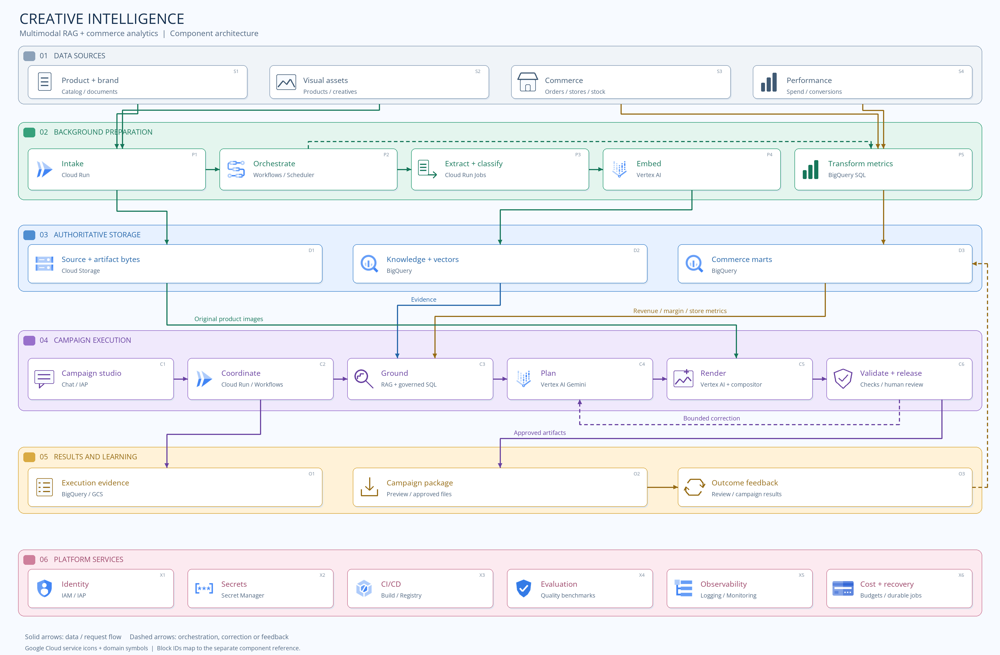

# Creative Intelligence

A Google Cloud platform for generating product-grounded marketing campaigns from
product knowledge, real imagery, brand rules and business context.

The intended experience is straightforward: a marketer selects a product,
describes a campaign, reviews the proposed creative and receives a campaign package
with its supporting evidence and validation results. The platform handles source
preparation, retrieval, generation and durable execution behind that experience.

[Interactive architecture](https://prateekcholkar80.github.io/creative-intelligence-architecture/)
· [Architecture proposal](docs/FUTURE_STATE_RAG_ARCHITECTURE.md)
· [Implementation checkpoint](docs/IMPLEMENTATION_PLAN.md)
· [Component reference](output/architecture/creative-intelligence-component-reference-v5.txt)



## Architecture

### Prepare reusable knowledge in the background

Protected intake establishes source ownership, SKU association, file identity and
provenance. Document workers extract and segment text; image workers classify
assets and prepare permitted product-image derivatives. Versioned embedding
profiles turn eligible text and images into searchable representations.

The target background pipeline coordinates these operations through durable jobs.
A change to original bytes, a parser or an embedding profile creates a new processing
version. Changes to access or permitted use update eligibility without requiring
unchanged content to be embedded again.

### Ground each campaign with evidence and analytics

Campaign grounding combines two distinct paths:

- **Knowledge retrieval:** scope-aware lexical and vector search, followed by
  semantic reranking, selects product facts, brand guidance, approved claims and
  relevant creative references.
- **Structured analytics:** governed BigQuery queries provide product revenue,
  margin, inventory, returns, store performance and campaign metrics with explicit
  definitions, time windows, currency and attribution context.

The selected evidence and metrics are bound to the campaign request. Actual
product-image bytes remain available to the model and compositor; embeddings do
not replace the source image. Commercial performance informs campaign decisions
but does not substantiate product efficacy claims.

### Plan, generate and validate

The campaign planner receives the brief and its bound evidence bundle, then
produces structured concepts, copy and layout instructions. Vertex AI supports
visual generation, while source-preserving composition retains the real product
asset and applies versioned typography and format settings.

Validation examines the actual artifact: product fidelity, claim support, brand
rules, safety, text and layout, and output dimensions. Corrections are bounded and
recorded. Review decisions bind to an exact version; generating an image does not
by itself authorize delivery or publication.

### Preserve durable execution and traceability

Each execution retains stable operation identifiers, exact inputs, provider
outcomes, model identities, available usage, artifact generations and measured
results. Recovery reads the original records. An uncertain provider call is held
for reconciliation rather than automatically repeated.

The orchestration layer coordinates work. BigQuery remains the database, vector
and durable business-record authority, while GCS stores original and derived
bytes. Framework state cannot substitute for evidence permissions or approval.

### Keep the team experience collaborative

Marketing defines the objective, audience, market and channel. Creative teams
select directions and refine the visual. Brand or claims reviewers resolve scoped
evidence questions. The platform presents readiness gaps, source references,
verification findings and version-specific approvals through chat and review
screens. Final delivery includes creative assets, copy, formats and an evidence
trail. Feedback and real campaign outcomes support later evaluation.

[View the user interaction diagram](output/architecture/creative-intelligence-user-interaction-v1.png)
· [Editable architecture SVG](output/architecture/creative-intelligence-architecture-compact-v5.svg)
· [Editable user interaction SVG](output/architecture/creative-intelligence-user-interaction-v1.svg)

## Components and responsibilities

| Component | Responsibility |
| --- | --- |
| BigQuery | Product knowledge, vectors, evidence, analytics, review records and durable execution records |
| Cloud Storage | Original documents and images, derived assets and campaign artifacts |
| Cloud Run | Protected application endpoints, application workers and rendering |
| Vertex AI | Embeddings, multimodal planning, reranking and visual generation |
| Workflows / Cloud Scheduler | Target background coordination and scheduled preparation |
| IAM / IAP / Secret Manager | Identity, narrowly scoped access and protected configuration |
| Cloud Build / Artifact Registry | Container builds and immutable deployment images |
| Cloud Logging / Monitoring | Operational diagnostics, stage timing, failures and usage visibility |

## Repository contents

| Path | Contents |
| --- | --- |
| `app.py` | Streamlit application entry point |
| `src/application/` | Protected services, domain contracts, access, durable execution and recovery |
| `src/ingestion/` | Data ingestion, generation and resource-setup utilities |
| `src/retrieval/` | Product, image, evidence and analytics retrieval |
| `src/generators/` | Model adapters, campaign planning and rendering |
| `src/ui/` | Campaign chat and protected operator interfaces |
| `src/validation/` | Explicit integration and native-cloud diagnostic runners |
| `tests/` | Unit and component tests |
| `config/` | Versioned application, evaluation and deployment configurations |
| `sql/` | BigQuery schemas and queries |
| `deploy/` | Container and Cloud Build definitions |
| `docs/` | Architecture, contracts, implementation history and release criteria |
| `assets/` | Bundled rendering fonts and their licenses/provenance |
| `output/architecture/` | Diagrams, editable SVGs, rendering scripts and component reference |
| `index.html` | Existing interactive GitHub Pages architecture explorer |

## Development setup

The current development environment uses Python 3.13. Create an isolated environment
and install the declared dependencies:

```sh
python3.13 -m venv .venv
.venv/bin/python -m pip install -r requirements.txt
```

The application entry point is:

```sh
.venv/bin/python -m streamlit run app.py
```

This command starts the interface; a clone alone does not supply product data,
Google Cloud resources, authenticated runtime configuration or approved prompts.
Existing configuration includes identifiers and bindings from the development
project. Review the [UI guide](docs/UI_GUIDE.md) and relevant
[deployment instructions](deploy/marketing/README.md) before configuring another
environment. There is no automatic cloud provisioning on clone.

For a focused offline verification of the private visual and artifact components:

```sh
.venv/bin/python -m unittest \
  tests.test_vertex_campaign_visual.VertexVisualTests \
  tests.test_vertex_scene_composition.VertexSceneCompositionTests \
  tests.test_campaign_visual_execution.VisualExecutionTests \
  tests.test_campaign_vertex_runtime.VertexRuntimeTests \
  tests.test_campaign_artifact_execution.ArtifactExecutionTests -q
```

Native diagnostic runners may create fixtures, execute cloud jobs or write records.
They require their own scoped configuration and authorization. Private datasets,
uploads, credentials and generated runtime evidence are excluded; see
[data/README.md](data/README.md).

## Implementation and delivery

This repository contains the complete local platform source snapshot alongside its
architecture design. The design spans capabilities at different implementation
stages; the current evidence and remaining gates are recorded in
[IMPLEMENTATION_PLAN.md](docs/IMPLEMENTATION_PLAN.md).

The immediate MVP target remains one complete Rejuvenate campaign using the saved
product data and uploads. The latest recorded checkpoint has the private Vertex
candidate controls deployed, with signed-in execution and complete campaign
qualification still outstanding. The qualifying full-pipeline benchmark remains
0/159 at that checkpoint. Architecture/framework migration is a separate Phase 2
plan, not an additional prerequisite for the immediate campaign.

The `master` branch contains the platform import. GitHub Pages remains configured
from `main`; the existing site and its configuration are preserved by this import.

## Source and asset provenance

Google Cloud service icons are sourced from the [official icon library](https://cloud.google.com/icons).
Icon provenance is recorded in `output/architecture/gcp-icons/SOURCE.txt`.
Bundled fonts retain their license and provenance files in `assets/fonts/campaign/`.
Third-party brand assets and private uploads are not included in this code import.
