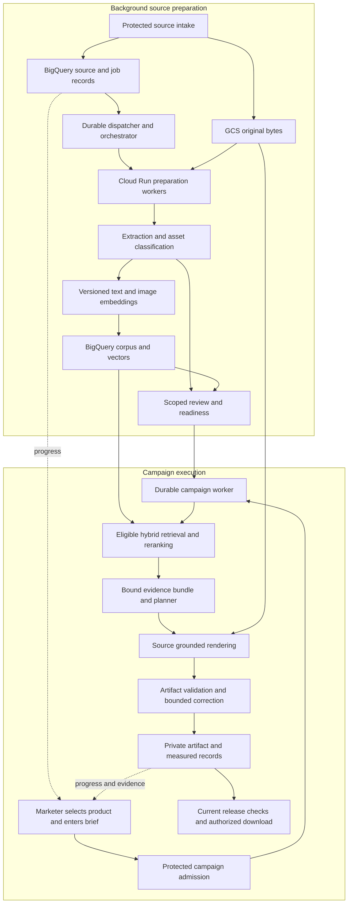

# Future state architecture for Creative Intelligence

Proposal date: 2026-10-21. Status: **Phase 2 architecture proposal**.

The target experience is a marketer selecting a product, describing a campaign,
and receiving a grounded banner with supporting evidence, validation results and
download access. Reusable product knowledge is prepared before the campaign
request. Campaign execution runs independently of the browser and reports durable
progress when the user reconnects.

**Immediate delivery remains one complete Rejuvenate campaign using the saved
product data and uploads.** The [fixed six-package MVP queue](IMPLEMENTATION_PLAN.md)
retains its scope and exit criteria. This proposal introduces no migration,
framework adoption or new infrastructure prerequisite for that campaign. The
[standard-library review](PHASE_2_STANDARD_LIBRARY_ARCHITECTURE.md) remains the
detailed Phase 2 replacement map.

## Assessment of the current architecture

The application has valuable foundations: protected source intake, immutable GCS
generation and content pins, BigQuery records, scoped access, versioned prompts,
provider outcomes, and original-job recovery. Preserve these contracts during
migration. The principal weakness is integration and responsibility boundaries:
too much source preparation and diagnostic recovery is exposed as user work.

This review is based on the current repository and recorded checkpoints. It is
not a fresh cloud inventory or a complete line-by-line audit. Deployed features,
local integration and proposed capabilities must remain distinguishable.

| Finding and code evidence | Consequence | Proposed treatment |
| --- | --- | --- |
| Upload advancement and private corpus/embedding operations are driven through UI actions: `campaign_attachment_batch.py`, `campaign_operator_console.py`, `campaign_corpus_preparation.py` | A refresh or expired session interrupts the apparent process and makes marketers act as operators | Durable background preparation; product readiness and business messages in the marketing UI |
| `campaign_retrieved_planner_runtime.py` locally joins retrieval recovery, reranking and planning, but still performs synchronous captures | A single method is useful integration, but does not prove independent background execution or acceptable latency | Reuse stage contracts; move execution ownership to durable workers after the MVP acceptance slice |
| `campaign_corpus_preparation.py` and planner guards repeat source/access/native evidence reads | Strong integrity, with repeated remote work and strict capture deadlines | Batch current mutable checks; reuse immutable content by exact identity; profile before changing proof boundaries |
| Recorded retrieval recovery phases total 117.321 seconds, while the recorded ranking job took 1.202 seconds | Verification/recovery work is a material latency contributor in this case | Measure the whole path and read amplification; do not describe this single sample as a percentile or general benchmark |
| `private_retrieval_rank.py` reads vectors from evaluator outcomes and computes exact cosine distance plus token overlap | Suitable bounded calibration foundation; not yet a general serving corpus or physical ANN index | Versioned typed BigQuery corpus/vector tables and a separate evaluation ledger |
| `campaign_hybrid.py` includes objective/audience preference ordering; the private semantic reranker is local | Preference matching and semantic relevance have different meanings | Keep explicit baselines; qualify semantic ranking against task-specific labels |
| The saved relevance query asks about application instructions | Its good result does not establish relevant evidence selection for banner creation | Add campaign-objective, claim-support and visual-reference retrieval cases |
| `embeddings_generator.py` has a legacy batch/cache/retry path; protected private embeddings use stable evaluator slots | Two execution contracts with different uncertainty handling | Migrate only through explicit source/profile/outcome parity, never by swapping the legacy loader into the protected path |
| Identity-copy checks and uploaded-image bindings are separate from claim approval and visual suitability | An authentic upload can still contain an unsuitable badge, testimonial or claim | Represent provenance, processing quality and permitted use as separate facts |

Current evidence covers one selected corpus of two TXT sources and one image,
three text embeddings, an index manifest and retrieval calibration with recovery.
The new retrieved-planner integration is local. A real rendered artifact and
complete qualifying campaign run remain pending; the full benchmark is **0/159**.
The latest recorded evidence is linked from [the implementation plan](IMPLEMENTATION_PLAN.md).

## Proposed component boundaries

These are logical boundaries, not a mandate to deploy a microservice for every
box. Initially use a small set of Cloud Run workers with shared typed contracts.
BigQuery remains the database, vector and durable business-record authority. GCS
holds original and derived bytes. Orchestrator state coordinates work; it cannot
approve evidence, establish a provider outcome or authorize a download.

## Background preparation

“Offline” means asynchronous preparation outside the marketer's request path.
It still uses cloud services and recorded provider calls where required.

1. **Accept and identify.** Validate allowed types, decoded content and the existing
   5 MiB per-file limit. Persist source identity, owner/workspace, intended SKU,
   content hash and original GCS generation. Keep original files immutable.
2. **Classify.** Identify product pack shots, lifestyle images, ingredient/reference
   graphics, clinical-result graphics, reviews, documents and unknown assets from
   their content. Record visible people, before/after content, badges, embedded
   claims and identity uncertainty. A filename or user's category is a hint.
   Ambiguous classification requires review; a classifier never supplies approval.
3. **Extract.** Parse documents with page/character provenance. OCR only when needed,
   retaining page/region coordinates, parser/OCR version and quality observations.
   Preserve ingredient lists, claim qualifiers and study conditions together when
   chunking; do not split a qualification from the statement it limits.
4. **Associate.** Validate SKU/formula/variant, market, language, source role and
   access scope. Store an explicit mapping; visual similarity cannot choose the
   authoritative product identity. Keep user-provided material private to its scope.
5. **Embed incrementally.** Embed text chunks and eligible visual references using
   pinned profiles. Reuse only exact compatible content/profile records. Store
   finite, nonzero vectors and provider outcome evidence in BigQuery.
6. **Publish a corpus revision.** Verify completeness and exact lineage, then update
   the current corpus pointer using the existing transaction/fence conventions.
   Incomplete revisions never replace a usable current revision.
7. **Project readiness.** Present what can be used for the requested campaign scope,
   along with specific missing evidence or review decisions. A processed file is
   not necessarily usable for claim copy or image generation.

Reprocessing follows changes: new bytes require new extraction and embeddings;
a parser change rebuilds affected chunks; an embedding-profile change creates a
parallel version; approval or membership changes invalidate eligibility without
automatically recomputing unchanged vectors. A confirmed duplicate may share
content computation within an authorized scope while retaining separate upload
receipts and lineage. Deduplication must not disclose another workspace's files.

The two pilot JPEGs were inspected as ingredient/benefit and clinician-review
graphics, not clean product pack shots. The selected WEBP contains a clinical
badge. The future classifier should surface these roles automatically, while the
first campaign resolves actual image use through the existing scoped process.

## Data and readiness contracts

The following are logical record families. Reuse compatible existing schemas;
introduce physical tables only through a reviewed migration.

| Record family | Essential identity and meaning |
| --- | --- |
| Source version | Workspace/owner, SKU mapping, source role, content hash, GCS generation, provenance and supersession |
| Extraction or visual observation | Source version, parser/model/prompt version, observed text/regions, segment hashes, uncertainty and original provider outcome |
| Corpus chunk | Source/extraction identity, exact text, offsets, section role, language, scope and current revision |
| Vector record | Content identity, modality, model/profile/task/dimension/normalization, vector, usage and durable outcome reference |
| Scoped permission | Exact facts/wording or image use, evidence and reviewer, formula/market/channel/audience, validity and revocation |
| Product corpus revision | Required source/chunk/vector identities, completeness, current pointer and superseded revisions |
| Campaign execution | Accepted brief, scope, delegated job authority, selected corpus, prompt/profile pins, stage outcomes and artifact references |
| Evaluation | Independent case/label version, actual inputs/outputs, component and artifact measurements, qualification decision |

Represent readiness on separate axes: processing status, source integrity, visual
suitability, scoped permitted use, retrieval coverage and generation/release
eligibility. The UI may summarize these as “Preparing,” “Ready for this brief,”
“Needs evidence/review,” or “Unavailable,” but the backend retains the reasons and
scope. “Ready” is recomputed against current authority when a campaign is admitted;
it is never an evergreen approval on the product.

Private evaluation records can establish execution evidence. Promotion into a
serving corpus requires explicit schema/provenance/permission verification and
an immutable migration record. Do not rename an evaluator binding to “approved
knowledge” or change its historical flags.

## Retrieval design

Use retrieval channels according to the question being answered:

| Need | Retrieval method | Use in generation |
| --- | --- | --- |
| Exact identity, size, price, availability, permitted wording | Scoped structured BigQuery reads | Exact facts and copy constraints; no fuzzy substitution |
| Product explanations, usage, ingredients, brand guidance | Section-aware lexical and text-vector candidates, fusion, bounded semantic reranking | Relevant context with original qualifications and source references |
| Product appearance and creative references | Explicit product-asset selection plus compatible visual/text-to-image retrieval where applicable | Original image bytes and role-specific references; similarity does not prove fidelity |
| Historical campaign performance and sales | Structured, scoped analytical queries | Grounded aggregates with time windows, sample sizes and synthetic/real provenance |

Text and image vectors from different embedding spaces are not comparable even
when their dimensions match. Keep compatible model/task versions together. A
text-to-image query must use a supported shared multimodal space; otherwise use
separate searches and fuse ranked IDs. Never average unrelated vector distances.
Image embeddings support discovery; the renderer and visual checker still need
the actual selected image bytes. A directly selected pack shot does not require
an artificial similarity search solely to make the pipeline appear multimodal.

Filter candidates by workspace/access, SKU or explicitly permitted reference
scope, market, channel, source role and current use eligibility **before** they
reach a reranker or generator. Unknown eligibility is not a no-match. Keep exact
fact/permission lookup independent of semantic ranking so a reranker cannot drop
a necessary disclaimer or substitute a similar product.

Retain exact cosine as the small-corpus baseline. The present lexical score is
token overlap, not BM25. Evaluate a better lexical candidate stage, then RRF and
semantic reranking on the same eligible set. Bound candidate count, context bytes,
images and output tokens. Choose top-k and relevance/no-match thresholds from
measured campaign cases; current three-chunk calibration cannot set production
thresholds. Reranking may change ordering, never permission. Gold labels and
expected decisions stay out of generator and reranker inputs.

For larger corpora, assess BigQuery `VECTOR_SEARCH` and physical vector indexes.
Pre-filtering depends on query shape and stored/partition columns; post-filtering
may return too few candidates. The current docs also restrict logical-view
pre-filters. Validate the exact eligibility query plan and recall before adopting
ANN; retain a bounded exact-search path when correctness requires it.
[BigQuery vector index filtering](https://docs.cloud.google.com/bigquery/docs/vector-index).

Record each retrieval's corpus/index/profile revisions, query identity, eligible
candidate IDs, ranks/scores, selected evidence, exclusions, latency and usage.
Persist sufficient references to reproduce the decision without duplicating
unrestricted raw content in every trace.

## Campaign execution and artifact quality

The marketer submits a brief and product selection once. The application admits
a durable request, returns its ID, and shows progress from recorded stages. It
asks for missing business information only when it affects the result. Diagnostic
Run/Recover buttons remain operator tools.

At execution time, resolve current identity and readiness; create the query and
retrieve eligible evidence; bind a bounded evidence bundle and exact approved
prompt/profile; plan; render; validate; persist; then evaluate current release
permission. Document extraction and unchanged document embeddings are reused.
Query embedding, relevance ranking, creative planning, rendering and final checks
depend on this request and remain campaign-time work, even when a worker runs them
asynchronously.

Maintain separate fields for source statements, approved copy and styling
references. The first Rejuvenate slice can use exact identity and a neutral CTA
without inventing benefit claims, but visible badges and embedded image claims
still need an appropriate image-use decision. Authentic brand origin alone does
not resolve that decision.

Prefer rendering that preserves the actual package and label, with controlled
composition where it protects fidelity. Evaluate source-grounded generative
background/layout capability as required by MVP; deterministic composition alone
does not satisfy that criterion. Store every derivative's input source, crop/mask
or transformation, prompt/model, bytes, dimensions, GCS generation and lineage.
Check final pixels for package/label fidelity, visible claims, people/before-after
restrictions, legibility, layout, format, brand and market/channel applicability.
A passing text schema cannot stand in for these checks.

Known repairable quality failures may take the existing bounded correction path.
Missing authority, revoked evidence and uncertain dispatch do not qualify for a
repair retry. Store private results and measured outcomes even when release is
withheld; authorize every visible preview and download using current access.

## Durable execution and managed service choices

Preferred Phase 2 infrastructure candidate: **Workflows coordinating bounded
Cloud Run workers/jobs**, with BigQuery stage admission and outcome records as
the business authority. Google documents Cloud Storage events through Eventarc
to Workflows and Cloud Run jobs. For this application, such an event is only a
wakeup: the worker must find the committed, authorized source/job before acting.
[Workflows with Cloud Run jobs](https://docs.cloud.google.com/workflows/docs/tutorials/execute-cloud-run-jobs).

Select one primary orchestration owner. Use Eventarc for source-event fan-out only
if needed. Consider Cloud Tasks instead for bounded HTTP work when queue rate
control is the actual requirement; do not add Workflows, Cloud Tasks and LangGraph
as three overlapping retry engines. Eventarc provides at-least-once delivery and
Cloud Tasks can also execute duplicates. Delivery success cannot prove stage
completion. [Eventarc retry semantics](https://docs.cloud.google.com/eventarc/docs/retry-events),
[Cloud Tasks execution limits](https://docs.cloud.google.com/tasks/docs/common-pitfalls).

Persist the accepted job and dispatch intent atomically where supported by the
existing BigQuery transaction contract. A dispatcher sends only job references;
reconciliation finds committed work whose external enqueue outcome was lost.
There is no assumed atomic transaction across BigQuery, GCS and a queue. Orphaned
objects, lost enqueue responses and out-of-order events require explicit recovery
and scoped cleanup. GCS finalization does not imply source registration succeeded.

The background worker uses its own narrow service identity plus a server-issued
job authorization bound to the admitting user, workspace, action, sources and
policy. It rechecks current membership, ownership, revocation and expiry at stage
boundaries and before output release. Never retain or replay an IAP bearer token
to simulate a continuing browser session. This delegated execution contract is
required implementation work; it is not supplied by choosing a queue.

Keep stable operation IDs and the current uncertainty rules. A reserved call
with no trustworthy outcome remains uncertain. Resume by recovering its original
provider/job evidence when available. If a provider supplies neither idempotency
nor recoverable results, the system cannot promise automatic exactly-once model
completion; hold that stage for explicit resolution. A workflow restart must not
turn the missing outcome into a fresh model call.

## Standard libraries and custom responsibilities

The existing [Phase 2 replacement map](PHASE_2_STANDARD_LIBRARY_ARCHITECTURE.md)
remains applicable, with these priorities:

| Choice | Recommendation | Responsibility retained by this application |
| --- | --- | --- |
| Google cloud/model SDKs | Keep as the default; consolidate compatible transport plumbing | Exact profile, provenance, usage, one-attempt dispatch and original outcomes |
| Pydantic, selective JSON Schema validation | Pilot strict external config/wire contracts | Canonical hashes, duplicate-key limits, cross-record policy and authority |
| Starlette/FastAPI and AnyIO | Assess API lifecycle and cancellation simplification after the campaign path works | IAP/access checks, bounded bodies, process isolation where necessary, unknown-outcome handling |
| OpenTelemetry with Cloud Logging | Standardize stage timing and correlation | Durable evidence, safe redaction, retention and qualification |
| LangGraph | Optional bounded routing experiment after the existing path has acceptance evidence | Admission, source authority, model idempotency and BigQuery records |
| LangChain | Optional adapters/splitters only when measured maintenance benefits exceed added abstraction | Provenance-preserving chunking, exact SDK evidence and scoped retrieval |

LangGraph persistence distinguishes graph checkpoints from application stores;
in-memory checkpoints do not survive restarts. Its documented persistence options
do not establish a BigQuery implementation for this project's contracts. Start
an experiment by reconstructing routing from existing records. Adopt durable
checkpointing only after resolving storage authority, privacy and maintenance;
do not silently add another database or build a large custom checkpointer merely
to claim code reduction. [LangGraph persistence](https://docs.langchain.com/oss/python/langgraph/persistence).

The architecture does not require an autonomous multi-agent system. A bounded
workflow with explicit retrieval and generation stages is the default. Add agent
planning only when evaluated tasks need it and authority boundaries remain clear.

## Performance and operational evidence

First measure source capture, mutable authority reads, native recovery, retrieval,
model inference, persistence and receipt delivery separately. Record request-to-
acknowledgment and request-to-artifact latency, p50/p95 under representative load,
queries/bytes scanned, repeated source downloads, queue age, token use and failures.
Set numeric acceptance targets from that baseline before rollout; this proposal
does not promise a latency or cost reduction.

Batch scoped current-row checks and avoid downloading an unchanged immutable
object merely to display progress. Cache only compatible immutable content and
versioned computations; current authorization and revocation remain enforced.
Invalidate readiness on source/policy changes. Load-test BigQuery control queries
and polling before scaling: its record/vector authority does not guarantee low
latency for every high-frequency UI interaction. If measured constraints cannot
be met, bring an explicit architecture decision rather than silently adding a
second operational database.

Carry 30-day raw-transcript retention into any new state, checkpoint, trace and
recovery artifact. Establish source/derived-asset retention separately; transcript
policy must not be assumed to authorize indefinite source retention. Deletion and
revocation must reach derived corpus entries and use eligibility. Credentials and
private raw content do not belong in queue payloads or telemetry.

## Evaluation and migration plan

| Sequence | Work and exit evidence | Classification |
| --- | --- | --- |
| Current MVP | Complete one Rejuvenate campaign from saved inputs, including real rendering, applicable scoring/recovery and the existing release approvals. Continue the fixed six packages. | Critical / Must have now |
| Phase 2 baseline | Inventory deployed versus local paths, define typed source/corpus/readiness contracts and measure latency/cost. Preserve source and native-job snapshots. | High / Must have before migration |
| Phase 2 preparation | Pilot one source revision through durable background processing; prove disconnect, duplicate events, revocation, partial writes, unknown outcomes and cleanup. | Critical / Must have for background adoption |
| Phase 2 retrieval | Build a parallel typed corpus projection; verify exact lineage and scope; compare exact/vector/lexical/fused/reranked results on independent campaign cases before ANN or profile changes. | High / Must have; access correctness Critical |
| Phase 2 campaign worker | Move one accepted campaign through independent execution and protected progress/download. Prove no browser token retention, no duplicate model dispatch and preserved release holds. | Critical / Must have for migration |
| Phase 2 simplification | Replace one generic component at a time using the library review; demonstrate parity and removal of replaced code. Reject migrations that increase orchestration/persistence complexity without measured benefit. | High / Good to have |
| Phase 2 rollout | Shadow read-only retrieval, then scoped canary execution; compare exact records, quality, latency and cost. Expand supported products/markets only after their acceptance evidence. | Critical / Must have before expansion |

Separate engineering tests from retrieval measurements and complete campaign
qualification. Build independent labels for campaign relevance, required evidence,
visual suitability and correct abstention. Split related documents/duplicate
assets across evaluation sets carefully to avoid leakage; include cross-SKU,
revoked/stale, injected-instruction, incompatible-vector and no-match cases.
The model being evaluated must not supply its own gold labels. Human calibration
of judges and actual rendered-image review are required parts of the evaluation
design. Synthetic performance data remains labeled simulation.

Roll back by disabling new admissions and returning the active corpus/runtime
pointer to the previously verified version. Preserve in-flight jobs and their
original execution owners; do not run old and new workers concurrently for the
same model slot. Keep failed outcomes and existing approvals immutable. Any schema
or SQL change must retain the legacy reconstruction needed to recover old jobs.

## Decisions to close before Phase 2 implementation

- Choose Workflows/jobs or a bounded queue worker from measured execution needs;
  confirm region, quota, IAM, cost and recovery behavior in the actual project.
- Agree classification/retrieval/artifact quality thresholds and latency budgets
  from independent baseline evidence; no invented “production-ready” score.
- Specify product/asset review authority and the supported market/channel matrix.
- Validate corpus table/query design and vector-profile compatibility before ANN
  adoption; keep exact search as the comparison baseline.
- Decide whether a library pilot removes enough custom code to justify migration.

These decisions belong to Phase 2 preparation. They do not delay the immediate
Rejuvenate campaign or replace its existing evidence and approval requirements.
