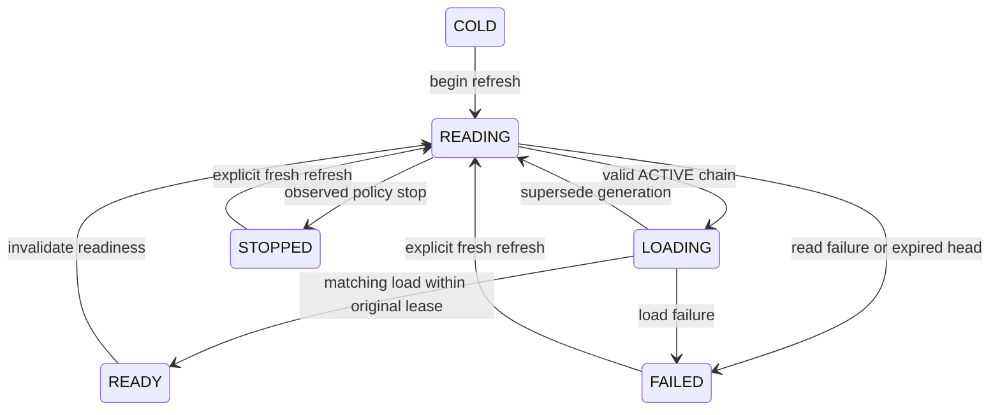

# Signing-policy publication and replica refresh contract

Priority 4 offline slice implemented on 2026-10-10 in
[sharing_publication_contract.py](../src/application/sharing_publication_contract.py)
and [sharing_refresh_contract.py](../src/application/sharing_refresh_contract.py).
These modules validate immutable proposals and supplied observations. They do
not publish/read BigQuery records, load secrets, synchronize replicas, swap a
sealer or enable execution. The [pinned loader](SHARING_SECRET_LOADER.md) remains
the separate secret-loading foundation.

## Revisioned publication and immutable history

`SigningPublication` binds the fixed `sharing-signing` policy namespace,
publication version, positive revision, parent digest, full secret-configuration
digest, status, UTC publication time and complete key history. Revision one has
no parent and only the initial configuration's history. Later proposals increment
exactly once, retain the parent's digest and cannot regress publication time.
Equivalent metadata ordering produces the same canonical digest. Hashes detect
changed content against a known pin; they do not authenticate a publisher.

Every historical key retains its identity/schedule, profile/settings/fingerprint,
secret/version binding and monotonic revocation flag. Active configurations still
use the existing eight-key limit. History remains after keys leave the active
configuration: retired IDs cannot return as new cohorts; their secret versions
cannot be reused under different IDs; historical profile IDs cannot be rebound.
Acceptance cohorts cannot overlap. Supplied consecutive transitions must match
the complete expected history, preventing history deletion or unrevocation.

History is bounded to 64 keys and the existing 64 KiB canonical JSON limit,
whichever is reached first. Exhaustion fails closed; no automatic pruning or
namespace reset is implemented. A future larger-history migration needs an
explicit retained-history/reader design. Publication metadata contains no key
bytes, product facts, raw identity assertions or tokens.

## Emergency policy stop

An ACTIVE publication must have an issuing active key at its publication time.
STOPPED preserves the last valid configuration and marks its active key revoked
in history. A stop cannot simultaneously change configuration and can be proposed
even after the old issuance interval ends. Repeated stops retain that revocation.

The saved configuration can still name the old active key as unrevoked because
the existing configuration type requires a valid active key. It is last-known
metadata, **never a loadable configuration for a stopped publication**. Replica
observation of STOPPED returns no load ticket and blocks readiness. Resuming
requires a valid replacement active key with the stopped key's revocation
preserved, or its lawful retirement from active configuration. Planned cohort
windows remain mandatory; unscheduled overlapping emergency rotation is not
introduced. Stop is a proposal until an authorized fenced writer commits it.

## Replica refresh state

The pure state flow is:



`begin_refresh` creates a new generation/read ticket and removes readiness before
authority is read. Tickets bind the caller-supplied replica instance ID and
generation. A new process must use a new instance ID. Against the current state,
late read/load/failure callbacks cannot overwrite a newer generation or another
instance. The contract does not generate IDs or perform a runtime compare/swap.

`observe_publications` accepts at most 16 unique consecutive revisions. It checks
the known head, exact parent chain, transition/history rules and captured read
time. Lower/conflicting revisions and skipped history are rejected. A cold
replica needs genesis or an explicitly trusted persisted checkpoint; a checkpoint
starts cold and never grants readiness. The future authoritative reader must
verify the unique current head, complete intervening history and checkpoint
source. Merely supplying a typed snapshot or current timestamp proves none of
those facts.

A valid higher head is pinned **before** loading keys. Load failure or expiry
keeps that revision floor while denying use. Read failure also denies use rather
than falling back to previously ready material. `complete_refresh` requires the
full exact loaded configuration digest, not just matching policy fields. Its
marker is trusted supplied metadata, not evidence that Secret Manager succeeded;
the runtime adapter must produce it from the actual pinned loader result.

The default readiness window is 30 seconds from the captured authority read,
configurable from 1–300 seconds and clipped at active-key issuance expiry.
Completion cannot extend it. Fresh observation of the same revision still needs
another key load before readiness is restored. Every protected operation must
check current readiness; completion and use reject expired or future read times.

## Authority and runtime limits

BigQuery remains the intended authority for publication/head/history and durable
revision floors; Secret Manager supplies bytes only. No local JSON registry or
serving fallback is added. Existing workflow schemas/tables are unchanged; [4.1's schemas and supplied-snapshot read contract](SHARING_PUBLICATION_STORAGE.md)
are defined offline. The subsequent [4.2 resource/read slice](SHARING_PUBLICATION_READER.md)
now provisions/verifies four empty control tables and implements codecs and fresh
SQL/SDK reads. The [authorized fenced writer](SHARING_PUBLICATION_WRITER.md) is
implemented with 519 affected offline tests and 13 passing isolated native cases.
[Controlled genesis bootstrap](SHARING_SIGNING_BOOTSTRAP.md) now completes 4.2's
implementation/native fixture scope. Serving activation remains deferred.

The runtime must atomically invalidate readiness and serialize/CAS transitions,
bind the active sealer to the exact ready publication, drop old material on
failure/stop, and check again before dispatch/result release. A caller retaining
an obsolete immutable Python state can still evaluate it; these pure functions
cannot discover the current process state, enforce locks or revoke old objects.
The [4.3 serialized runtime sealer](SHARING_RUNTIME_REFRESH.md) now owns live
state and key references under one lock, performs fresh reads/loads and checks
readiness before signing/resolution and result release. It requires an authoritative
checkpoint equal to the head. The [runtime executor adapter](SHARING_RUNTIME_EXECUTOR.md)
now implements dispatch and protected release gates with current access checks and
613 passing affected offline tests. No serving route/UI is wired; isolated real-resource
checks remain pending within 4.3.

An unrefreshed replica's lease is not erased by another replica observing a stop.
Bounded freshness alone does not provide instantaneous global revocation or
fence in-flight operations. Publication freshness, refresh cadence, stronger
operation-level authority checks, durable restart floors, permissions/auditing
and operational revocation rollout must be verified before shared activation.
Never infer latest authority from a digest, publication timestamp or Python type.

## Verification

All **379 affected offline tests passed**, including **44 new tests** in
[test_sharing_publication.py](../tests/test_sharing_publication.py):

```bash
.venv/bin/python -m unittest tests.test_sharing_publication tests.test_sharing_secret_loader tests.test_sharing_signing tests.test_sharing_retry_integration tests.test_sharing_integration tests.test_sharing_retry_executor tests.test_sharing_retry tests.test_sharing_receipt tests.test_sharing_executor tests.test_sharing_query tests.test_sharing_coordinator_contract tests.test_access_reader tests.test_identity
```

Coverage includes canonical metadata, parent conflicts, revision exhaustion,
rotation/revocation/retirement, permanent ID/version/profile history, policy stop
and safe resume, missing/conflicting history, checkpoint/restart behavior, stale
callbacks, fail-closed refresh, exact load markers, original lease deadlines,
issuance expiry, extreme time boundaries and the lack of instantaneous replica
revocation. No full-suite/native probes were rerun; no cloud calls, schema/data
writes, secret access/provisioning, IAM/user/approval changes, model invocations,
deployments or execution-default changes occurred.

## Next small steps

Follow the [fixed Priority 4 baseline](IMPLEMENTATION_PLAN.md#fixed-remaining-priority-4-milestones).
This contract is complete offline; its remaining integration belongs to:

1. (High; Must have — shared pilot) **4.1 — Complete:** [Explicit control schemas and read design](SHARING_PUBLICATION_STORAGE.md), including retention, unique-head and bounded chain/hash checks. 443 affected tests pass; the eleven workflow definitions are unchanged.
2. (Critical; Must have — shared pilot) **4.2 — Complete within implementation/native fixture scope:** [Resource setup, strict codec and authoritative reader](SHARING_PUBLICATION_READER.md), the [fenced writer](SHARING_PUBLICATION_WRITER.md) and [controlled bootstrap](SHARING_SIGNING_BOOTSTRAP.md) are implemented and verified. Real serving bootstrap and shared activation are deferred.
3. (Critical; Must have — shared pilot) **4.3:** Serialized runtime refresh and operation gates using fresh BigQuery state and pinned secret loading, with isolated real-resource restart, rotation and revocation verification.

The remaining service/workflow/UI work keeps IDs **4.4–4.7** in that baseline.
No additional milestones are introduced by this document. Use the plan’s severity/necessity tags and dependency-aware Must have delivery lane for all subsequent changes.
